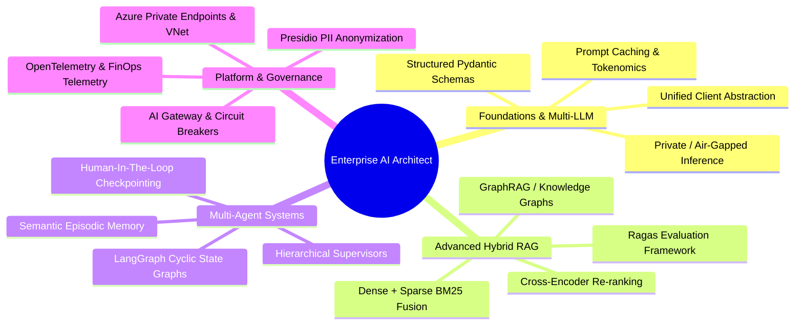
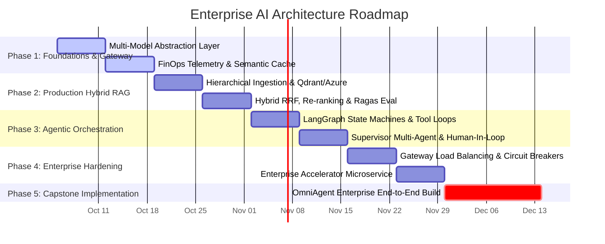
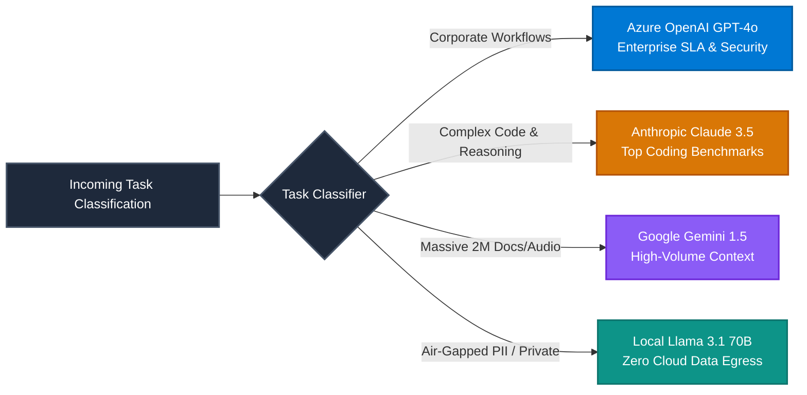
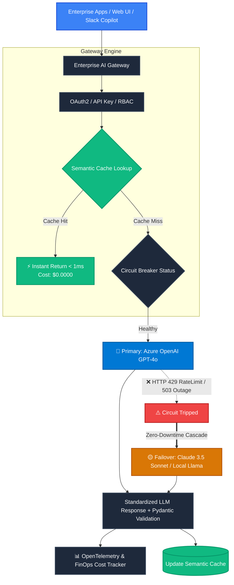
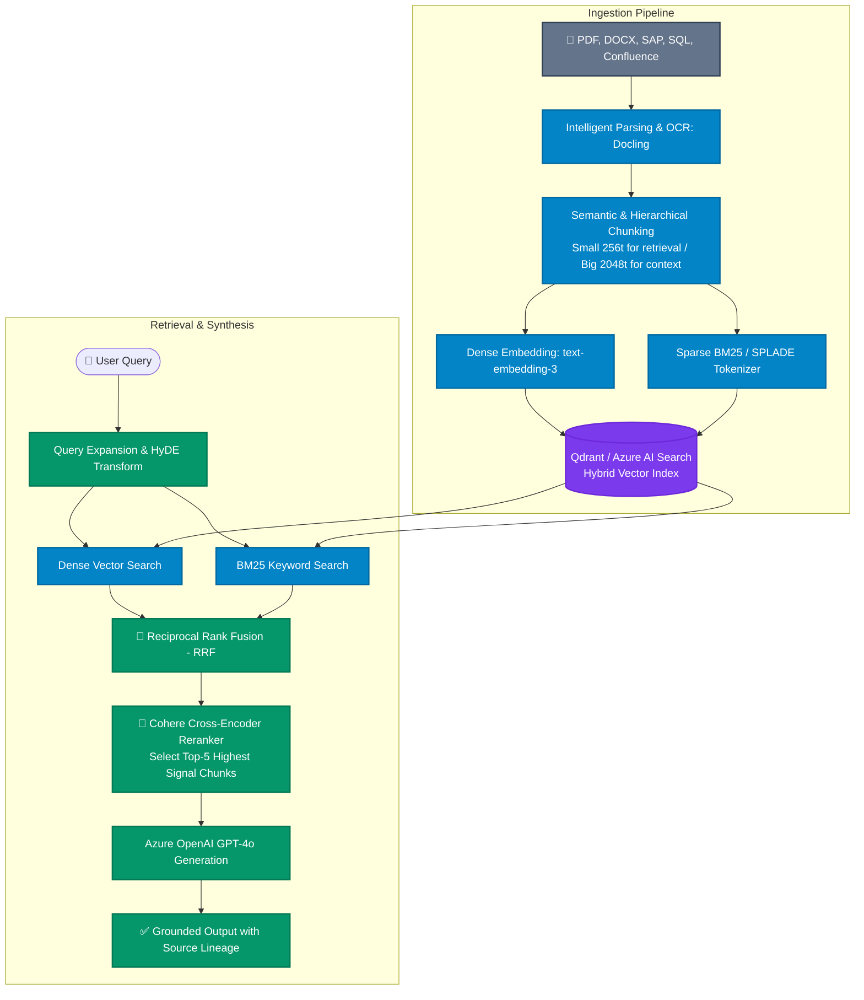
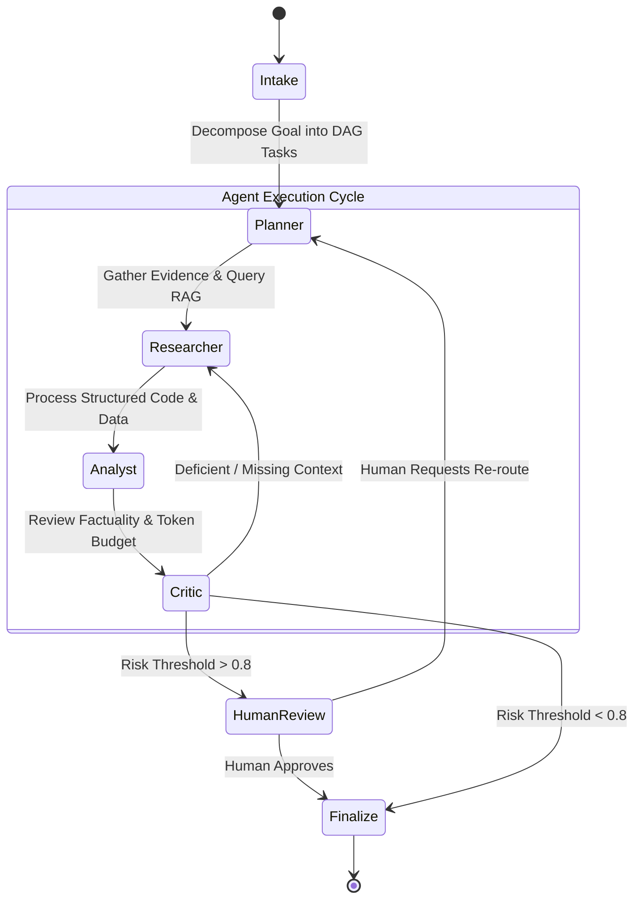
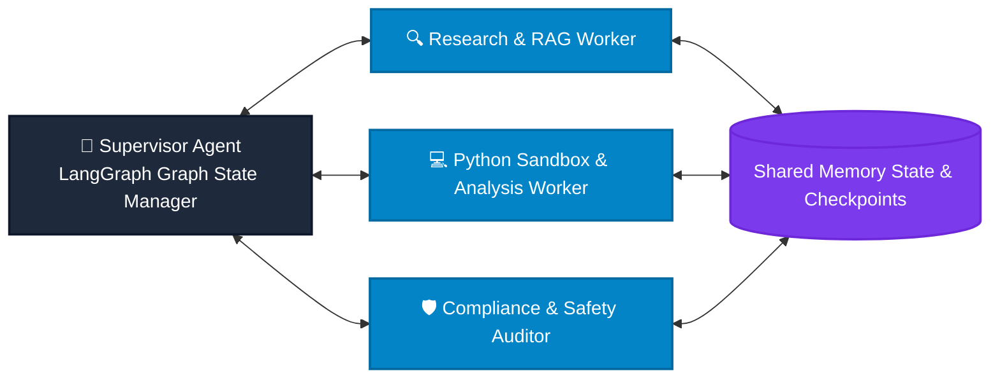
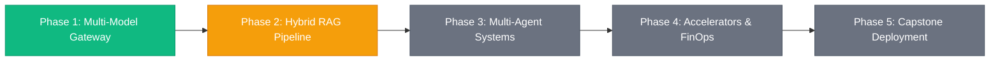

# 🏛️ Enterprise AI Solution Architecture Blueprint & Roadmap
### *Zero-to-Production Reference Architecture & Accelerator Framework*

<div align="center">


</div>

---

> [!IMPORTANT]
> **Executive Mandate:** In enterprise environments, AI applications cannot rely on single-vendor APIs or naive prompt-and-response designs. Production resilience demands **multi-provider failover, strict Pydantic typed contracts, deterministic guardrails, zero-PII egress paths, and sub-millisecond semantic response caching**.

---

## 📑 Interactive Table of Contents

- [🏛️ Executive Competency Matrix](#-executive-competency-matrix)
- [🗺️ 12-Week Zero-to-Architect Execution Plan](#️-12-week-zero-to-architect-execution-plan)
- [🌐 Multi-Model Landscape & FinOps Economics](#-multi-model-landscape--finops-economics)
- [⚡ Enterprise AI Gateway & Failover Topology](#-enterprise-ai-gateway--failover-topology)
- [🔍 Advanced Hybrid RAG Architecture](#-advanced-hybrid-rag-architecture)
- [🤖 Multi-Agent Orchestration & State Graph](#-multi-agent-orchestration--state-graph)
- [🛡️ Enterprise Security, Governance & PII Isolation](#️-enterprise-security-governance--pii-isolation)
- [🚀 Capstone Project Blueprint: OmniAgent Enterprise](#-capstone-project-blueprint-omniagent-enterprise)

---

## 🏛️ Executive Competency Matrix



---

## 🗺️ 12-Week Zero-to-Architect Execution Plan



| Phase | Core Focus | Key Technologies | Status |
| :---: | :--- | :--- | :---: |
| **01** | **Multi-Model Gateway & Abstraction** | Azure OpenAI, Claude 3.5, Gemini 1.5, Ollama, Pydantic | 🟢 **Scaffolded & Verified** |
| **02** | **Enterprise Hybrid RAG Pipeline** | Qdrant, Azure AI Search, BM25, Cohere Rerank, Ragas | 🟡 **Next Target** |
| **03** | **Multi-Agent Systems & Copilots** | LangGraph, AutoGen/CrewAI, Redis State, Human-in-the-loop | ⚪ *Planned* |
| **04** | **Scalable Patterns & Accelerators** | FastAPI Microservices, Circuit Breakers, Presidio PII | ⚪ *Planned* |
| **05** | **Capstone Enterprise Solution** | Full-Stack Autonomous Research Copilot with Generative UI | ⚪ *Planned* |

---

## 🌐 Multi-Model Landscape & FinOps Economics

> [!TIP]
> **FinOps Optimization:** Never send raw bulk documentation to high-cost reasoning models. Route document ingestion to **Google Gemini 1.5 Flash** (\$0.075/1M), deep agentic code reasoning to **Claude 3.5 Sonnet**, mission-critical enterprise workflows to **Azure OpenAI GPT-4o**, and air-gapped sensitive PII to **Local Llama 3.1** (\$0.00).



### Enterprise Model Selection Matrix

| Provider & Model | Primary Use Case | Prompt Cost (1M) | Comp Cost (1M) | Latency SLA | Security / Compliance |
| :--- | :--- | :---: | :---: | :---: | :--- |
| 🔵 **Azure OpenAI GPT-4o** | Default Enterprise Copilot & Synthesis | \$2.50 | \$10.00 | ⚡ 400–800ms | HIPAA, SOC2, Azure Private VNet |
| 🟡 **Claude 3.5 Sonnet** | Advanced Code Generation & Multi-Step Logic | \$3.00 | \$15.00 | ⚡ 500–900ms | AWS Bedrock / GCP Vertex Hosting |
| 🟣 **Gemini 1.5 Pro / Flash** | 2M Context Ingestion & Multimodal Video/PDF | \$0.075–\$1.25 | \$0.30–\$5.00 | ⚡ 250–500ms | Google Cloud Vertex AI Governance |
| 🟢 **Local Llama 3.1 70B** | Air-Gapped Regulated Data / Zero Cloud Egress | **\$0.00** | **\$0.00** | ⚡ Hardware Dependent | On-Premise GPU / Zero Data Leakage |

---

## ⚡ Enterprise AI Gateway & Failover Topology

The AI Gateway provides an abstraction wall between consuming applications and underlying LLM infrastructure.



> [!CAUTION]
> **Cascading Failures:** When configuring automated failovers, ensure secondary providers have pre-allocated rate limits. If a 10,000 RPM traffic spike trips Azure OpenAI, failing over to an unreserved fallback account will instantly throttle the secondary provider. Always enforce token rate limiting at the Gateway layer!

---

## 🔍 Advanced Hybrid RAG Architecture

*Naive RAG (top-k semantic cosine similarity) fails in 30–40% of enterprise queries due to keyword mismatch and lost context.*  
The production architecture implements **Hybrid Search + Reciprocal Rank Fusion + Cross-Encoder Re-ranking**.



---

## 🤖 Multi-Agent Orchestration & State Graph

Complex business workflows require multi-step task planning, specialized tools, and human review before irreversible execution.



### Agent Role Breakdown



---

## 🛡️ Enterprise Security, Governance & PII Isolation

> [!NOTE]
> **Data Privacy Guarantee:** Customer PII (Social Security Numbers, Credit Cards, Medical Records) must be neutralized before leaving the enterprise boundary.

```mermaid
flowchart LR
    classDef input fill:#3B82F6,stroke:#1D4ED8,color:#FFFFFF,stroke-width:2px;
    classDef guard fill:#DC2626,stroke:#991B1B,color:#FFFFFF,stroke-width:2px;
    classDef cloud fill:#059669,stroke:#047857,color:#FFFFFF,stroke-width:2px;

    User[User Input]:::input --> PII[🛡️ Microsoft Presidio PII Masker]:::guard
    PII --> Injection[🛡️ Prompt Injection Classifier]:::guard
    
    Injection -->|Clean Payload| Gateway[Secure AI Gateway]:::cloud
    Gateway --> LLM[Enterprise Azure OpenAI]:::cloud
    
    LLM --> OutFilter[🛡️ Output Hallucination & Toxicity Filter]:::guard
    OutFilter --> Anonymizer[De-anonymize PII Tokens for Authorized User]:::cloud
    Anonymizer --> Output[Secure Response to Client]:::input
```



---

## 🚀 Capstone Project Blueprint: OmniAgent Enterprise

The capstone project combines every architectural pillar into a production-grade, deployable microservice platform:

```
omniagent-enterprise/
├── docker-compose.yml                      # Qdrant + Redis + FastAPI + Frontend
├── services/
│   ├── ai-gateway/                         # Multi-Model Smart Router & Caching
│   │   ├── core/                           # Provider abstraction & FinOps telemetry
│   │   └── providers/                      # Azure, Claude, Gemini, Local Llama
│   ├── rag-service/                        # Document ingestion, RRF & Re-ranking
│   ├── agent-engine/                       # LangGraph multi-agent state machines
│   └── web-copilot/                        # Next.js / React Generative UI
└── tests/
    ├── eval_ragas.py                       # Automated RAG evaluation benchmarks
    └── test_failover_resilience.py         # Chaos testing for LLM outages
```

---

## 🏁 Immediate Action Items & Phase Milestones



- [x] **Phase 1 Foundation**: Scaffolded multi-provider abstraction with Azure OpenAI, Claude, Gemini, Local Llama, and Mock fallback.
- [x] **Verification Labs**: Executed multi-model query test, strict Pydantic parsing, and zero-downtime failover drill.
- [ ] **Phase 2 Ingestion**: Connect Qdrant vector database and implement hybrid BM25 + dense search pipeline.
